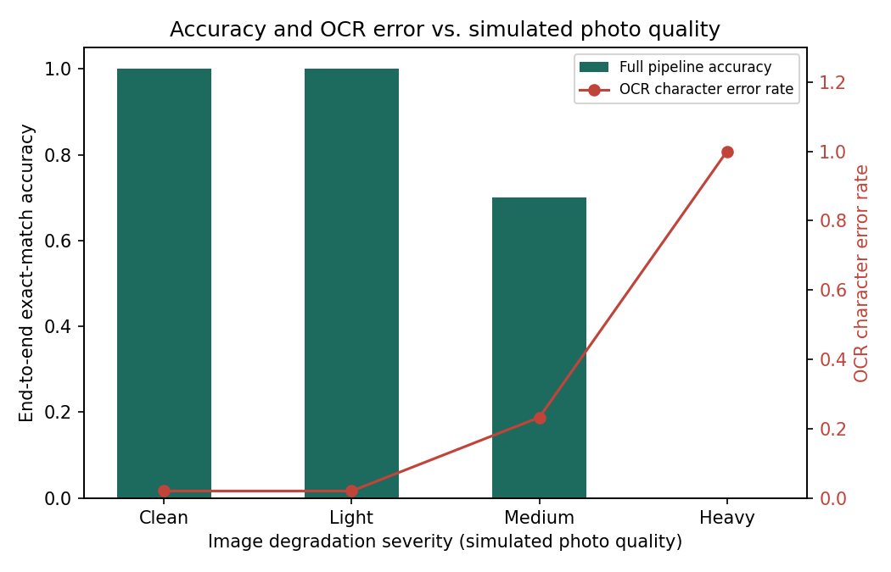
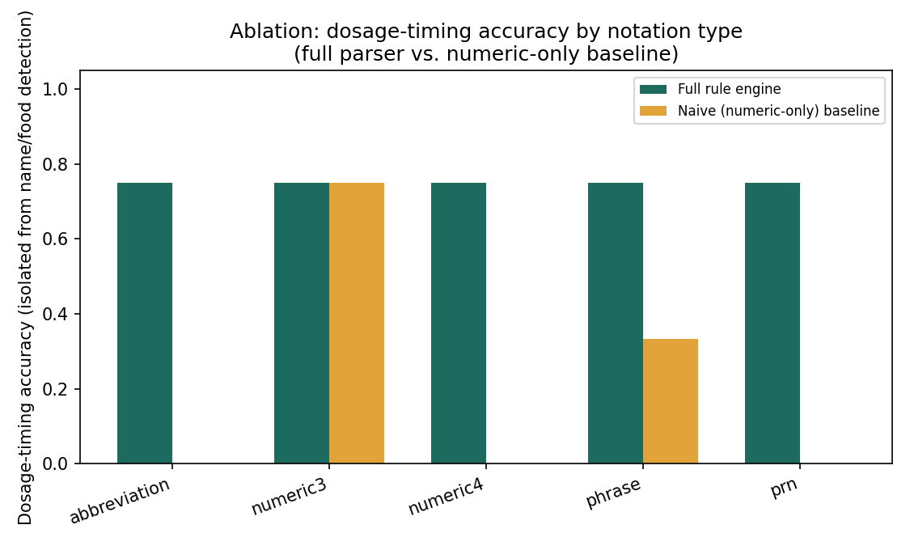
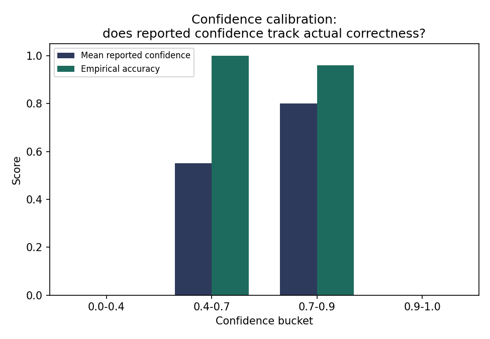

# Evaluation Results

Benchmark size: **40 images** (10 label templates x 4 degradation levels). Evaluation runtime: 7.0s.

- **Overall end-to-end accuracy (full pipeline):** 67.5%
- **Overall end-to-end accuracy (naive baseline):** 0.0%
- **Mean OCR character error rate:** 31.8%

## Accuracy by image degradation level

| Level | n | Mean OCR CER | Full pipeline accuracy | Baseline accuracy |
|---|---|---|---|---|
| clean | 10 | 2.0% | 100.0% | 0.0% |
| light | 10 | 2.0% | 100.0% | 0.0% |
| medium | 10 | 23.2% | 70.0% | 0.0% |
| heavy | 10 | 100.0% | 0.0% | 0.0% |

## Ablation: dosage-timing accuracy by notation type

Isolated to dosage-timing detection only (the baseline never attempts name or food-timing detection, so those are excluded here for a fair, apples-to-apples comparison of *which notations each parser can read*).

| Pattern type | n | Full rule engine | Naive (numeric-only) baseline |
|---|---|---|---|
| abbreviation | 12 | 75.0% | 0.0% |
| numeric3 | 8 | 75.0% | 75.0% |
| numeric4 | 4 | 75.0% | 0.0% |
| phrase | 12 | 75.0% | 33.3% |
| prn | 4 | 75.0% | 0.0% |

## Full end-to-end accuracy by notation type (name + timing + food)

| Pattern type | n | Full pipeline | Naive baseline |
|---|---|---|---|
| abbreviation | 12 | 66.7% | 0.0% |
| numeric3 | 8 | 75.0% | 0.0% |
| numeric4 | 4 | 75.0% | 0.0% |
| phrase | 12 | 58.3% | 0.0% |
| prn | 4 | 75.0% | 0.0% |

## Confidence calibration

| Confidence bucket | n | Mean reported confidence | Empirical accuracy |
|---|---|---|---|
| 0.0-0.4 | 12 | 0.00 | 0.0% |
| 0.4-0.7 | 3 | 0.55 | 100.0% |
| 0.7-0.9 | 25 | 0.80 | 96.0% |
| 0.9-1.0 | 0 | 0.00 | 0.0% |

## Figures

## Caveats

This is a small, synthetic, English-only benchmark built to exercise every rule branch in the parser under controlled, reproducible image degradation. It is useful for regression testing and for relative comparisons (this version vs. that version; full parser vs. baseline). It is **not** a substitute for evaluation on a large, de-identified sample of real prescription photos across handwriting styles, printers, languages, and camera hardware, which would be necessary before relying on these numbers for any real-world deployment.